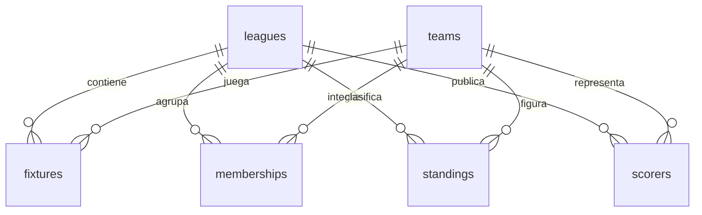

# Arquitectura y contrato de datos

## Estructura del repositorio

```text
latente/
  backend/
    app/                 API, cliente del proveedor, normalización y worker
    migrations/          revisiones Alembic versionadas
    tests/               integración, cuotas y normalización
    Dockerfile
    requirements*.txt    versiones fijadas
  frontend/
    src/                 interfaz Preact y estilos
    public/              favicon, cabeceras Pages y tema
    Dockerfile           build estático e inicialización de volumen
    package-lock.json
  deploy/
    nginx/nginx.conf
    compose.tunnel.yml
  scripts/               GitHub, backup y smoke test
  docs/                  arquitectura, validación y capturas
  .github/workflows/ci.yml
  .env.example
  docker-compose.yml
  README.md
```

## Modelo relacional

| Tabla | Clave | Responsabilidad |
| --- | --- | --- |
| `leagues` | `source, id` | Competición, temporada seleccionada, años y capacidades del proveedor |
| `teams` | `source, id` | Identidad estable y perfil del equipo; un fixture abreviado no borra el perfil |
| `memberships` | `source, league_id, season, team_id` | Equipos por competición y temporada |
| `fixtures` | `source, id` | Inicio UTC, estado, marcador nullable, equipos, torneo, ronda, estadio y desglose de score |
| `standings` | `source, league_id, season, group, team_id` | Todas las zonas y fases, sin combinar grupos |
| `scorers` | `source, league_id, season, player_id, team_id` | Ranking del proveedor y estadísticas por jugador/equipo |
| `sync_jobs` | `key` | Próxima ejecución, último éxito, parámetros y contador de fallas |
| `api_usage` | `day` | Consumo persistido por día UTC, saldo remoto y pausa global |
| `worker_state` | `source` | Heartbeat y estado resumido del proceso |



`source` es `demo` o `api`. Es parte de todas las relaciones de datos deportivos; no puede asociarse un resultado real a un equipo demo. `TIMESTAMP WITH TIME ZONE` conserva instantes; el filtro por fecha convierte la medianoche de la zona elegida a un intervalo UTC, incluyendo días de cambio horario. Un gol `NULL` se muestra como `—`, no como cero.

Los índices de fixtures cubren fecha, competición/temporada y equipos local/visitante. JSON conserva únicamente estructuras variables como cobertura, temporadas, score y parámetros del scheduler; la consulta principal sigue siendo relacional.

## Ingesta y consistencia

1. Un worker mantiene un advisory lock de PostgreSQL en una conexión dedicada. Un segundo worker no comienza a consumir la API. Al perder esa conexión, el proceso falla y Docker puede reiniciarlo.
2. El catálogo identifica la temporada marcada `current` o un override válido; las temporadas anteriores quedan almacenadas. Los trabajos de una temporada retirada se eliminan del scheduler, no se borran sus datos deportivos.
3. Cada solicitud reserva su cupo en una transacción bloqueando `api_usage`. El contador se confirma **antes** de salir a la red; reiniciar el contenedor no reinicia la cuota.
4. El cliente usa HTTPS, timeout, validación de `errors` incluso con HTTP 200, separación entre consultas y `Retry-After` en 429. Los secretos y mensajes externos completos no se escriben en logs.
5. El snapshot se normaliza y confirma completo. Fixtures/equipos se actualizan por upsert; posiciones y goleadores se reemplazan de forma atómica para esa temporada. Una respuesta vacía conserva la copia anterior y su fecha, evitando borrar por falta transitoria de datos. Un snapshot inválido revierte la transacción.
6. El seguimiento de juego consulta lotes de hasta 20 IDs: partido conocido desde 5 min antes del inicio, encuentro `NS` hasta 4 h después del horario, o estado de juego de hasta 36 h. Los IDs menos recientemente actualizados tienen prioridad. Consultar por ID permite capturar el resultado final.
7. La API pública solo lee PostgreSQL. Navegar o refrescar una página nunca inicia consultas pagas ni cambios de datos. No existe endpoint administrativo público.

Los trabajos vencidos se atienden por fecha, de a uno, con una pausa entre intentos. Las frecuencias son objetivos, no garantías; el presupuesto, la cantidad de lotes y la cola pueden alargarlas. Una respuesta paginada se reúne antes de publicar el snapshot. Si la cuota se agota durante las páginas, no se publica un conjunto incompleto y se reintenta posteriormente.

En el modo demo el reloj y los resultados son una muestra estática del día: no se inventa un flujo de goles en vivo. Los datos se regeneran al cambiar el día de Argentina. La interfaz mantiene el aviso de demostración también en fichas, tablas y detalle de partidos.

## API pública

Todos los endpoints de datos devuelven `{ data, meta }`; `meta` indica modo, proveedor, hora de consulta y última actualización cuando corresponde. `/api/health` es una comprobación breve de DB.

| Ruta | Parámetros | Resultado |
| --- | --- | --- |
| `GET /api/health` | — | Disponibilidad de API y conexión DB |
| `GET /api/status` | — | Heartbeat, cuota, demoras y estado de configuración; sin secretos |
| `GET /api/leagues` | — | Ligas configuradas y temporadas cargadas |
| `GET /api/fixtures` | `date` requerido; `tz`, `league_id`, `live`, `limit` 1–300, `offset` | Fixture del día, con total para paginar |
| `GET /api/fixtures/{id}` | — | Estado, equipos y marcador por períodos |
| `GET /api/leagues/{id}/standings` | `season` opcional | Todas las tablas/grupos de la temporada |
| `GET /api/leagues/{id}/scorers` | `season` opcional | Ranking sincronizado de goleadores |
| `GET /api/teams` | `league_id` requerido; `season`, `q` opcionales | Directorio de equipos |
| `GET /api/teams/{id}` | — | Perfil y hasta 8 partidos anteriores y 8 próximos |
| `GET /api/docs` | — | Explorador OpenAPI |

Los partidos en vivo con una antigüedad mayor a `max(120 s, 2 × LIVE_INTERVAL_SECONDS)` se marcan demorados. Esta señal no certifica que los restantes marcadores sean instantáneos: mide la última consulta de la aplicación, no la latencia interna del proveedor.

## Operación y límites

- Un proceso de worker por base; varias réplicas de API pueden compartir PostgreSQL. Para alta disponibilidad real se necesitan despliegue redundante y PostgreSQL administrado/replicado.
- El pool de la API está limitado a 5 conexiones + 5 de overflow por proceso. Ajustar según réplicas y conexiones disponibles.
- No hay datos personales de usuarios ni cuentas de acceso. El tema de color se guarda solo en el navegador.
- El presupuesto evita superar el tope configurado por esta aplicación, pero otros consumidores de la misma clave pueden agotar la cuota remota antes. Se respeta el saldo reportado por el proveedor.
- Las fechas antiguas solo están disponibles si se cargó esa temporada. La interfaz nunca hace backfill por visitante. Para conservar varias temporadas, sincronizalas sucesivamente con `SEASON_OVERRIDES` y luego volvé a `current`.
- Los empates en posiciones y criterios de desempate provienen del proveedor; no se recalcula el ranking en el frontend. El campo de descripción de zonas puede venir en el idioma del proveedor.
- No se reconstruyen encuentros eliminados por el proveedor ni se infiere la eliminación a partir de una respuesta vacía. Una eliminación excepcional requiere revisar el dato fuente antes de corregir la base.
